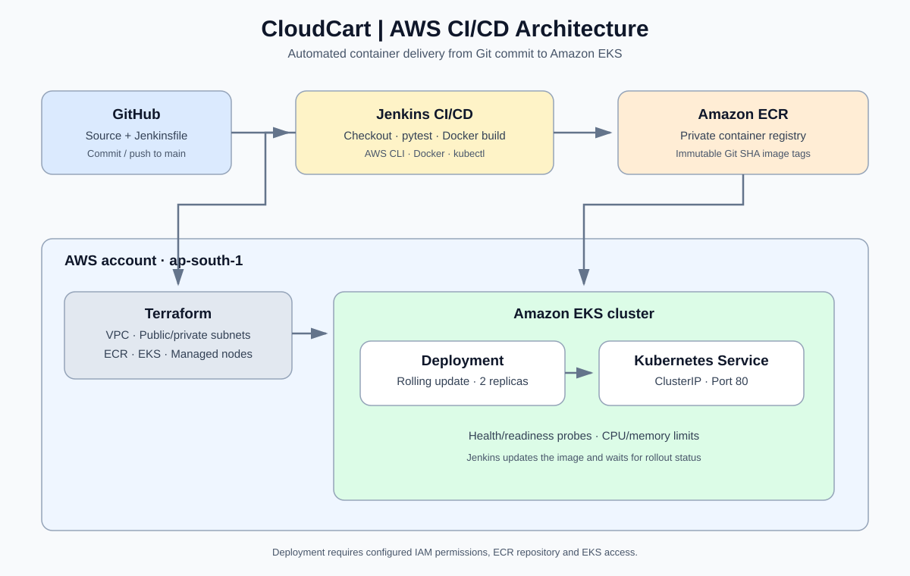

# CloudCart — Enterprise AWS DevOps CI/CD

A portfolio project implementing an automated delivery pipeline for a containerized Python API using GitHub, Jenkins, Docker, Amazon ECR, Amazon EKS, Terraform, and Kubernetes.



## Architecture

**GitHub push → Jenkins → Unit tests → Docker build → Amazon ECR → Amazon EKS rollout**

Terraform provisions the AWS foundation: VPC networking, public/private subnets, ECR, EKS, and managed worker nodes. Jenkins builds an image tagged with the source Git commit SHA, pushes it to ECR, and updates the EKS Deployment.

## Technology

- Git and GitHub
- Jenkins Declarative Pipeline
- Python, Flask, pytest
- Docker multi-stage build
- Amazon ECR
- Amazon EKS and Kubernetes
- Terraform
- AWS CLI and kubectl

## Repository structure

```text
.
├── app/
│   ├── app.py
│   └── requirements.txt
├── tests/
│   └── test_app.py
├── terraform/
│   ├── versions.tf
│   ├── variables.tf
│   ├── main.tf
│   ├── outputs.tf
│   └── terraform.tfvars.example
├── k8s/
│   ├── deployment.yaml
│   └── service.yaml
├── scripts/
│   └── deploy-to-eks.sh
├── docs/
│   └── architecture.svg
├── Dockerfile
├── Jenkinsfile
└── requirements-dev.txt
```

## Application endpoints

| Endpoint | Purpose |
|---|---|
| `/` | Application information |
| `/health` | Liveness check |
| `/ready` | Readiness check |
| `/version` | Application version |
| `/api/v1/products` | Sample product data |

## Infrastructure naming

Default region: `ap-south-1`

With the default Terraform values:
- ECR repository: `cloudcart-dev-api`
- EKS cluster: `cloudcart-dev-eks`
- Kubernetes namespace: `cloudcart`

Change these values consistently if you change the Terraform naming configuration.

## Pipeline stages

1. Checkout the source.
2. Install Python dependencies and run pytest.
3. Verify the AWS identity and ECR repository.
4. Build the Docker image using the Git commit SHA as its tag.
5. On `main`, authenticate to ECR and push the image.
6. On `main`, configure kubectl, update the EKS Deployment, and wait for rollout completion.
7. Fail the pipeline when a required command fails.

## AWS setup prerequisites

Before executing Terraform or enabling deployment, configure:

- An AWS account and an IAM identity allowed to provision the required VPC, ECR, EKS, and IAM resources.
- Terraform and the AWS provider/module versions declared in the configuration.
- A supported EKS Kubernetes version for the chosen region.
- A Jenkins agent with Git, Python 3 with venv support, Docker Engine, AWS CLI, kubectl, and network access to AWS APIs.
- An AWS IAM role for the Jenkins agent. Prefer an EC2 instance profile or another short-lived credential mechanism instead of static AWS keys.
- ECR push permissions for the Jenkins role.
- EKS access for the Jenkins role. Set `jenkins_role_arn` in Terraform and apply the access entry before deploying. The example grants edit access in the `cloudcart` namespace; review permissions against your requirements.
- A Jenkins job configured to build this repository's `Jenkinsfile`, with the `main` branch available to the job.
- An EKS cluster and the ECR repository created by Terraform before the first deployment.

## Security and cost notes

- The sample Terraform enables public EKS API endpoint access from `0.0.0.0/0` to make the template easier to adapt. Restrict this to trusted IP ranges before deploying.
- A single NAT gateway is used as a cost-conscious development default; it is not a highly available production networking design.
- EKS worker nodes and NAT gateways incur AWS charges. Review the Terraform plan and cost estimate before applying.
- The sample does not create an external ingress controller or public load balancer. The Kubernetes Service is internal (`ClusterIP`).
- Image scanning on push is enabled at the ECR repository level.
- No AWS access keys, kubeconfig files, Terraform state, or secrets should be committed.

## Important scope

This repository contains the project implementation template and configuration. Creating files and pushing this repository to GitHub does not provision AWS infrastructure or prove that a deployment has succeeded. Execute and validate the infrastructure and pipeline in an appropriately configured AWS/Jenkins environment before describing a deployment as completed.
